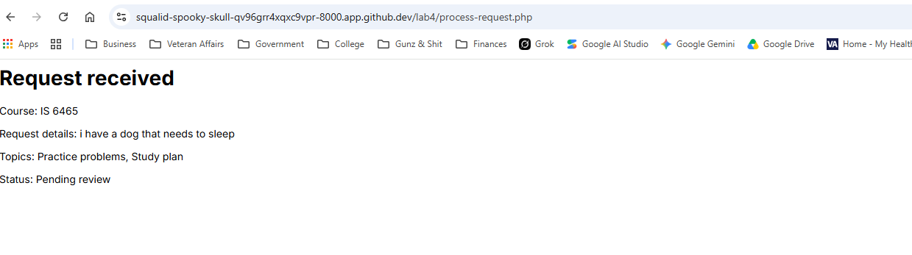
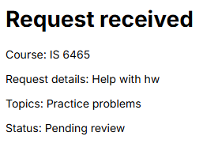
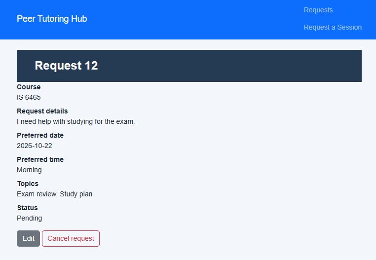

1. Post submission of a valid tutoring request, the process request page was presented showing a transcript of each form field submitted. 
2. 
    2a. What content does header.php provide to every page? It supplies the HTML skeleton: the doctype, html and head elements including charset, viewport, Bootstrap CSS, the shared css/styles.css stylesheet. 
    2b. What content does nav.php provide? It supplies the shared navigation bar at the top including the requests.php and request-form.php
    2c. What content does footer.php provide? It supplies the page footer (a centered “Peer Tutoring Hub” line), the Bootstrap JavaScript bundle, and the closing body and html tags.
    2d. Why is require_once appropriate for these files? require_once guarantees the templates are loaded exactly once and that execution stops with a clear error if a required file is missing, preventing duplicate output.
    2e. Where is the shared CSS file linked? The shared stylesheet (css/styles.css) is linked inside includes/header.php via a link rel="stylesheet" tag in the head.

3. 
    3a. reason: This is required textarea that colelcts a free-text description of what the student wants help with. PHP receives it as a sing string in $_POST['reason'].
    3b. Topics[]: These are checkboxes (Exam review, Practice problems, Study plan) that let the user select one or more topics. Because the name ends in [], PHP receives the checked values as an array in $_POST['topics'] (or an empty array if none are selected).
    3c. preferredtime: These are radio buttons that require users to choose exactly one preferred time of day (Morning, Afternoon, or Evening). PHP receivees the selected value as a single string in $_POST['preferredtime'].
    3d. preferreddate: This is a required input type="date" that collects the student’s preferred session date. PHP receives the value as a string in Y-m-d format in $_POST['preferreddate'].
    3e. This is a hidden field that identifies the form as a tutoring request. PHP receives the fixed string "tutoring_request" in $_POST['form_name'], which the processing script uses as a simple validity check.

4. 
    4a. Valid Submission: 
        Values: Practic Problems, Afternoon, Course IS 6465, Preferred date: 10/26/26, Text: Help with hw,
        Message Displayed: 
        Business Rule: Process-request.php, Validation, if there are not errors display, echo's of form submission

    4b. Missing submission:
        Values:  Topic (Blank), Morning, Course IS 6465, Preferred Date: 10/26/26, Text: Help with hw
        Message Displayed: 
        Business Rule: Process-request.php, Validation, Select at least one valid topic

    4c. Past Date:
        Values:  Topic: Practice Problems , Morning, Course IS 6465, Preferred Date: 10/20/26, Text: Help with hw
        Message Displayed: 
        Business Rule: Process-request.php, Validation, Date cannot be in the past

5. 
    5a. Open tests/validation-tests.php
        Valid time: PASS
        Missing time: PASS
        Altered value: PASS
        Multiple valid topics: PASS
        Missing topics: PASS
        Altered topic: PASS
        Minimum length: PASS
        Maximum length: PASS
        Too short: PASS
        Too long: PASS
    
    5b. Open requests.php 

    5c. CREATE: request-form.php
        READ (one requests): process-request.php
        READ (all requests): requests.php
        UPDATE: edit-requests.php
        DELETE: delete-requests.php
    
What query parameter appears in the request details URL? 
    request_id (example: request-details.php?request_id=12).

Why is a GET query parameter appropriate for viewing one request?
    Viewing a request is a safe, read-only (idempotent) operation. GET is the correct HTTP method for retrieving data without changing anything on the server, and the request_id in the query string clearly identifies which resource to display.

Why should an actual update or delete later use POST rather than GET?
    Update and delete change data. Using GET would allow those actions to be triggered accidentally by browsers, search engines, or simple links (and would violate HTTP semantics). POST (or DELETE/PUT) ensures the action only happens when the user deliberately submits a form.

