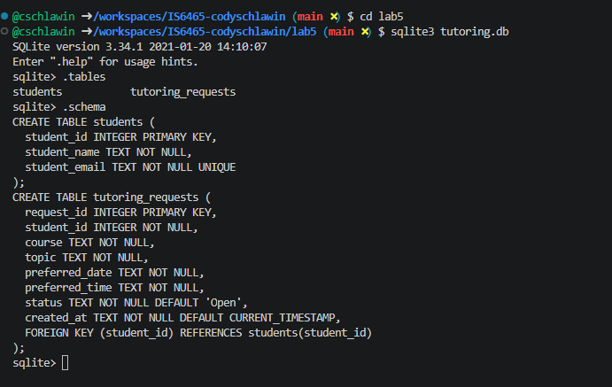

# Lab 5 Notes: Build and Query the Peer Tutoring Hub Database

**Student:** Cody Schlawin  
**Course:** IS 6465 Web Application Development  
**Date:** November 2, 2026

## Part 1: Create the database tables

### 1. Screenshot or pasted output showing both table names and the table schema

After running the CREATE TABLE statements, the following output was produced in the SQLite shell:


```
.tables
students
tutoring_requests

.schema
CREATE TABLE students (
  student_id INTEGER PRIMARY KEY,
  student_name TEXT NOT NULL,
  student_email TEXT NOT NULL UNIQUE
);

CREATE TABLE tutoring_requests (
  request_id INTEGER PRIMARY KEY,
  student_id INTEGER NOT NULL,
  course TEXT NOT NULL,
  topic TEXT NOT NULL,
  preferred_date TEXT NOT NULL,
  preferred_time TEXT NOT NULL,
  status TEXT NOT NULL DEFAULT 'Open',
  created_at TEXT NOT NULL DEFAULT CURRENT_TIMESTAMP,
  FOREIGN KEY (student_id) REFERENCES students(student_id)
);
```

### 2. Which column is the primary key in each table?

- In the `students` table, the primary key is `student_id`.
- In the `tutoring_requests` table, the primary key is `request_id`.

### 3. Which column is the foreign key, and what relationship does it represent?

The foreign key is `student_id` in the `tutoring_requests` table. It references `students(student_id)`. This represents a one-to-many relationship: one student can submit many tutoring requests, and each tutoring request belongs to exactly one student.

### 4. Why is student_email marked UNIQUE?

The `student_email` column is marked UNIQUE so that the database prevents two different student rows from having the same email address. This ensures each email identifies exactly one student and avoids duplicate or conflicting student records.

## Part 2: Insert students and tutoring requests

### 1. The INSERT statements you used

```sql
-- Insert each student once
INSERT OR IGNORE INTO students (student_name, student_email)
VALUES
  ('Jordan Lee', 'jordan.lee@example.edu'),
  ('Avery Patel', 'avery.patel@example.edu');

-- Jordan Lee - Request 1: Forms
INSERT INTO tutoring_requests (student_id, course, topic, preferred_date, preferred_time)
VALUES (1, 'IS 6465', 'Forms', '2026-11-10', '14:00');

-- Jordan Lee - Request 2: SQL SELECT
INSERT INTO tutoring_requests (student_id, course, topic, preferred_date, preferred_time)
VALUES (1, 'IS 6465', 'SQL SELECT', '2026-11-12', '10:30');

-- Avery Patel - Request: SQLite CRUD
INSERT INTO tutoring_requests (student_id, course, topic, preferred_date, preferred_time)
VALUES (2, 'IS 6465', 'SQLite CRUD', '2026-11-15', '13:00');
```

### 2. Pasted SELECT * output that shows the rows in both tables

**students table:**
```
1|Jordan Lee|jordan.lee@example.edu
2|Avery Patel|avery.patel@example.edu
```

**tutoring_requests table:**
```
1|1|IS 6465|Forms|2026-11-10|14:00|Open|2026-11-02 21:39:24
2|1|IS 6465|SQL SELECT|2026-11-12|10:30|Open|2026-11-02 21:39:24
3|2|IS 6465|SQLite CRUD|2026-11-15|13:00|Open|2026-11-02 21:39:24
```

### 3. An explanation of why Jordan has one student row but two request rows

Jordan has only one student row because student information (name and email) is stored once in the `students` table. The two tutoring requests are stored as separate rows in the `tutoring_requests` table, both linked to Jordan’s single `student_id` via the foreign key. This design avoids repeating student data and correctly models the one-to-many relationship.

## Part 3: Read the stored data

### JOIN query SQL and output

```sql
SELECT
  r.request_id,
  s.student_name,
  s.student_email,
  r.course,
  r.topic,
  r.preferred_date,
  r.preferred_time,
  r.status
FROM tutoring_requests AS r
JOIN students AS s ON r.student_id = s.student_id
ORDER BY r.preferred_date;
```

**Output:**
```
1|Jordan Lee|jordan.lee@example.edu|IS 6465|Forms|2026-11-10|14:00|Open
2|Jordan Lee|jordan.lee@example.edu|IS 6465|SQL SELECT|2026-11-12|10:30|Open
3|Avery Patel|avery.patel@example.edu|IS 6465|SQLite CRUD|2026-11-15|13:00|Open
```

### Questions

1. **What does the JOIN condition connect?**  
   The JOIN condition (`r.student_id = s.student_id`) connects each tutoring request row to the matching student row by matching the foreign key in `tutoring_requests` to the primary key in `students`. This brings the student’s name and email into the result alongside the request details.

2. **What is the difference between the purpose of JOIN and WHERE?**  
   JOIN combines related rows from two or more tables based on a matching condition so you can retrieve data that spans tables. WHERE filters rows (from one or more tables) based on a condition, keeping only the rows that meet the criteria. JOIN is about relating tables; WHERE is about restricting which rows are returned.

3. **Why should the application retrieve one request by request_id instead of by topic alone?**  
   The `request_id` is a unique primary key that identifies exactly one request. A topic is not unique—multiple students (or the same student) could request tutoring on the same topic. Retrieving by topic alone could return multiple rows or the wrong request, while retrieving by `request_id` guarantees the exact record intended.

## Part 4: Update one request

### 1. The two UPDATE statements you used

```sql
-- Update one of Jordan's open requests (request_id = 1)
UPDATE tutoring_requests
SET topic = 'Forms and validation',
    preferred_time = '15:30'
WHERE request_id = 1;

-- Change Avery's request status to Cancelled (request_id = 3)
UPDATE tutoring_requests
SET status = 'Cancelled'
WHERE request_id = 3;
```

### 2. Before-and-after output for the revised request

**Before update of request_id 1:**
```
1|Forms|14:00|Open
```

**After update of request_id 1:**
```
1|Forms and validation|15:30|Open
```

### 3. Query result showing Avery's Cancelled status

```
3|2|SQLite CRUD|Cancelled
```

### 4. Why is a specific WHERE clause essential in an UPDATE statement?

A specific WHERE clause is essential because without it, the UPDATE would change every row in the table. The WHERE clause limits the change to only the intended row(s), preventing accidental modification of all data.

### 5. Why does the Peer Tutoring Hub use a Cancelled status instead of immediately deleting a real request?

Using a Cancelled status preserves the historical record of the request for auditing, reporting, and possible future reference. Deleting a real request would permanently remove evidence that the request was made. A status change keeps the data while clearly indicating the request is no longer active.

## Part 5: Delete one test request

### 1. The INSERT statement for the test request

```sql
INSERT INTO tutoring_requests (student_id, course, topic, preferred_date, preferred_time)
VALUES (1, 'IS 6465', 'Delete Practice', '2026-12-01', '09:00');
```

### 2. The DELETE statement you used

```sql
DELETE FROM tutoring_requests
WHERE request_id = 4;
```

### 3. Output that verifies the test record was removed

**Before delete (including test request):**
```
1|Forms and validation|Open
2|SQL SELECT|Open
3|SQLite CRUD|Cancelled
4|Delete Practice|Open
```

**After delete:**
```
1|Forms and validation|Open
2|SQL SELECT|Open
3|SQLite CRUD|Cancelled
```

The test record (request_id 4, topic “Delete Practice”) is gone, while the other three requests remain.

### 4. Why is a WHERE clause essential in a DELETE statement?

A WHERE clause is essential because without it, the DELETE statement would remove every row from the table. The WHERE clause restricts the deletion to only the specific test record identified by its primary key, protecting the real data.

## Part 6: Reflect on the CRUD workflow

| CRUD action | SQL statement used in this lab | Peer Tutoring Hub example |
|-------------|-------------------------------|---------------------------|
| Create      | INSERT                        | Adding a new student and a new tutoring request |
| Read        | SELECT (including JOIN)       | Displaying all open requests with the student’s name and email |
| Update      | UPDATE                        | Changing a request’s topic/time or setting a request status to Cancelled |
| Delete      | DELETE                        | Removing a clearly labeled test request by its request_id |

### Questions

1. **How does the database preserve the connection between a student and that student's requests?**  
   The connection is preserved by the foreign key `tutoring_requests.student_id`, which stores the primary key value from the `students` table. Every request row points back to exactly one student row through this shared identifier.

2. **Which database constraint prevents two student rows from using the same email address?**  
   The UNIQUE constraint on the `student_email` column.

3. **What could happen if an UPDATE or DELETE statement did not include a WHERE clause?**  
   An UPDATE without a WHERE clause would modify every row in the table. A DELETE without a WHERE clause would remove every row from the table. Both could cause irreversible data loss.

4. **When the application later receives values from an HTML form, why should PHP send those values as parameters instead of placing them directly into SQL text?**  
   Using parameters (prepared statements) prevents SQL injection. If form values are concatenated directly into SQL text, a malicious user could inject extra SQL commands. Parameters keep the data separate from the SQL structure, so the database treats the values only as data, not as executable SQL.
